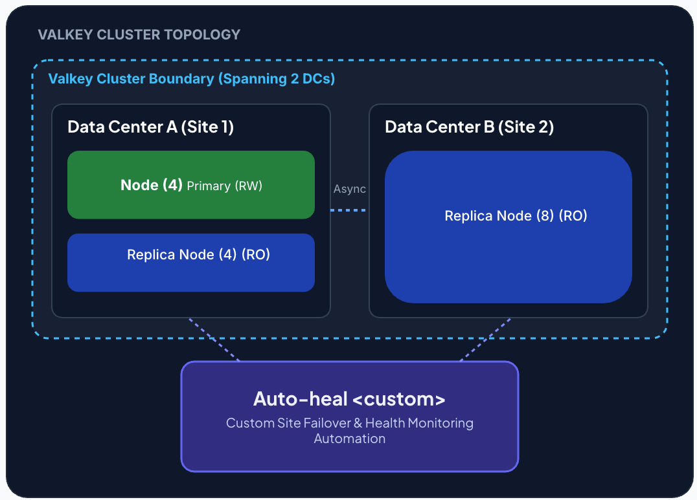
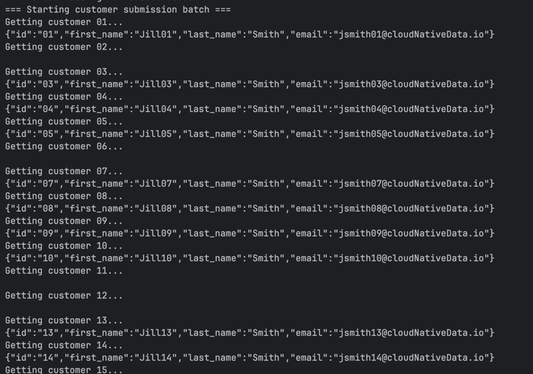

# Valkey 2-Site Cluster Setup & Failover Simulation

A hands-on workshop guide for deploying a 16-node multi-site Valkey cluster using Podman, testing cross-site application failover, and diagnosing split-brain scenarios.




The activity simulates a site failure.  The [split brain failover detection script](deployments/local/scripts/2-sites/valkey-cluster-auto-heal.sh) automates promoting replicas in site 2, if all the primaries are down.


# 1. Prerequisites

Ensure your system meets the following requirements before starting:

- Podman installed and running 
- Java 17+ runtime installed 
- Pre-built application JAR at applications/customer-service/target/customer-service-0.0.1-SNAPSHOT.jar

### Local DNS Configuration

Append the following host mappings to /etc/hosts (requires sudo):

```text
127.0.0.1    valkey-server-7011
127.0.0.1    valkey-server-7012
127.0.0.1    valkey-server-7013
127.0.0.1    valkey-server-7014
127.0.0.1    valkey-server-7015
127.0.0.1    valkey-server-7016
127.0.0.1    valkey-server-7017
127.0.0.1    valkey-server-7018
127.0.0.1    valkey-server-7021
127.0.0.1    valkey-server-7022
127.0.0.1    valkey-server-7023
127.0.0.1    valkey-server-7024
127.0.0.1    valkey-server-7025
127.0.0.1    valkey-server-7026
127.0.0.1    valkey-server-7027
127.0.0.1    valkey-server-7028
```

# 2. Environment Preparation 

Create an isolated Podman bridge network and runtime directories for node persistence:

```shell
podman  network  create valkey
```


## 2. Start Valkey Nodes

Launch Valkey server containers split across two simulated sites:

```shell
# Launch Site 1 (Ports 7011 - 7018)
echo "Starting Site 1 nodes..."
for port in {7011..7018}; do
  podman run -d --rm \
    --network=valkey \
    -p ${port}:${port} \
    --hostname "valkey-server-${port}" \
    --name "valkey-server-${port}" \
    valkey/valkey:9.1 \
    valkey-server \
      --port ${port} \
      --cluster-announce-hostname "valkey-server-${port}" \
      --cluster-preferred-endpoint-type hostname \
      --cluster-enabled yes
done

# Launch Site 2 (Ports 7021 - 7028)
echo "Starting Site 2 nodes..."
for port in {7021..7028}; do
  podman run -d --rm \
    --network=valkey \
    -p ${port}:${port} \
    --hostname "valkey-server-${port}" \
    --name "valkey-server-${port}" \
    valkey/valkey:9.1 \
    valkey-server \
      --port ${port} \
      --cluster-announce-hostname "valkey-server-${port}" \
      --cluster-preferred-endpoint-type hostname \
      --cluster-enabled yes
done
```


## 3. Initialize the Cluster

Join the 6 individual nodes into a cluster with 1 replica per primary:

```shell
podman exec -it valkey-server-7011 valkey-cli  -p 7011 --cluster create valkey-server-7011:7011 valkey-server-7012:7012 valkey-server-7013:7013 valkey-server-7014:7014 valkey-server-7015:7015 valkey-server-7016:7016 valkey-server-7017:7017 valkey-server-7018:7018 valkey-server-7021:7021 valkey-server-7022:7022 valkey-server-7023:7023 valkey-server-7024:7024 valkey-server-7025:7025 valkey-server-7026:7026 valkey-server-7027:7027 valkey-server-7028:7028  --cluster-replicas 3 --cluster-yes
```


### Run Auto-Heal Promotion Helper

Run the auto-heal watcher container to enforce rack/site replica topology and promotions:


```shell
podman rm -f valkey-check
podman run --network=valkey  --rm -d --name valkey-check -v "$(pwd)/deployments/local/scripts/2-sites/valkey-cluster-auto-heal.sh:/scripts/valkey-cluster-auto-heal.sh:ro,Z" valkey/valkey:9.1

podman exec -it valkey-check bash /scripts/valkey-cluster-auto-heal.sh --cluster-nodes "valkey-server-7011:7011 valkey-server-7012:7012 valkey-server-7013:7013 valkey-server-7014:7014 valkey-server-7015:7015 valkey-server-7016:7016 valkey-server-7017:7017 valkey-server-7018:7018 valkey-server-7021:7021 valkey-server-7022:7022 valkey-server-7023:7023 valkey-server-7024:7024 valkey-server-7025:7025 valkey-server-7026:7026 valkey-server-7027:7027 valkey-server-7028:7028" --replicas-to-promote " valkey-server-7015:7015 valkey-server-7016:7016 valkey-server-7017:7017 valkey-server-7018:7018 valkey-server-7021:7021 valkey-server-7022:7022 valkey-server-7023:7023 valkey-server-7024:7024 valkey-server-7025:7025 valkey-server-7026:7026 valkey-server-7027:7027 valkey-server-7028:7028"
```


## 4. Run Application & Workload Generation

**Terminal 1: Launch Customer Service**
Start the Spring Boot microservice using the 3-replica cluster profile:

```shell
java -jar applications/customer-service/target/customer-service-0.0.1-SNAPSHOT.jar --spring.profiles.active=3replics --server.port=8070
```


**Terminal 2: Run Workload Loop**

Run the continuous read/write load test to observe cluster behaviour during disruptions:

```shell
./deployments/local/scripts/user-loop-test.sh
```


## 5. Inspect Cluster Health

Open an interactive valkey-cli session in cluster mode (-c):


```shell
podman exec -it valkey-server-7016 valkey-cli -c -p 7016 -h 127.0.0.1
```
From inside the CLI, inspect cluster status and primary/replica role assignments:

```shell
CLUSTER NODES
CLUSTER INFO
```

Confirm that cluster_state:ok and all 16,384 hash slots are assigned across primaries.


## 6. Simulate Site Failure & Failover


Phase A: Partial Failure (Site 1 Primaries)

Simulate an failures of the first 4 nodes on Site 1:

```shell
podman rm  -f valkey-server-7011
sleep 10
podman rm  -f valkey-server-7012
sleep 10
podman rm  -f valkey-server-7013
sleep 10
podman rm  -f valkey-server-7014
```


View Cluster Details 


The auto heal will eventually maintain a cluster (state=0k)

```shell
podman exec -it valkey-server-7016 valkey-cli -p 7016 cluster info | grep cluster_state
```


**Phase B: Catastrophic Outage (Site 2 Complete Loss)**
Stop all nodes in Site 2 simultaneously. Only 4 nodes will remain active in Site 1:

```shell
podman rm -f valkey-server-702{1..8}
 ```

ecause quorum is lost, the client test script will encounter HTTP 500 errors as hash slots become unavailable:

Example Errors

    Getting customer 03...
    {"timestamp":"2026-08-12T20:12:31.481+00:00","status":500,"error":"Internal Server Error","path":"/customers/03"}


Execute the split-brain failover detection script to recover the surviving majority after 3 failed detections:

> Warning: Forced failover in a partitioned network may result in un-replicated data loss between the old primaries and promoted replicas.



-------------------

## 7. Cleanup
   To teardown containers and remove generated configuration/runtime files:

```shell
# Stop and remove all workshop containers
podman rm -f valkey-check $(podman ps -aq --filter "name=valkey-server-70*") 2>/dev/null || true
```

